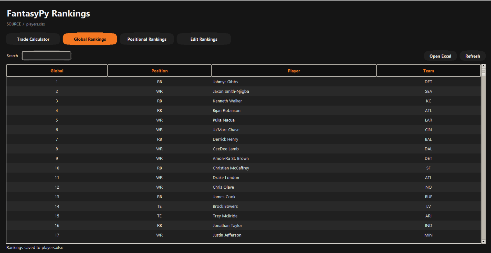
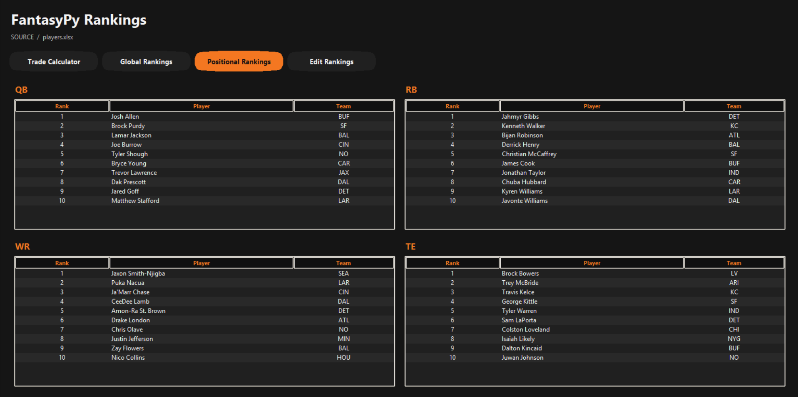
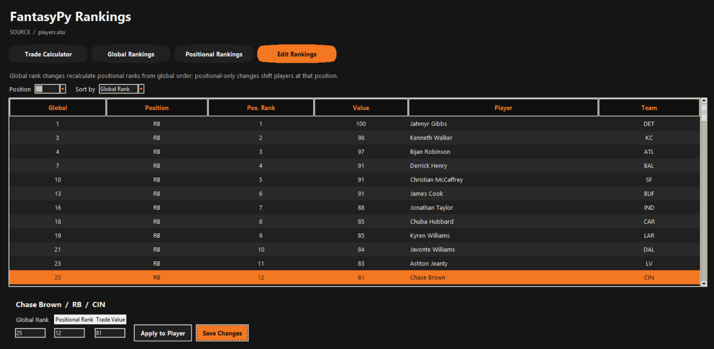
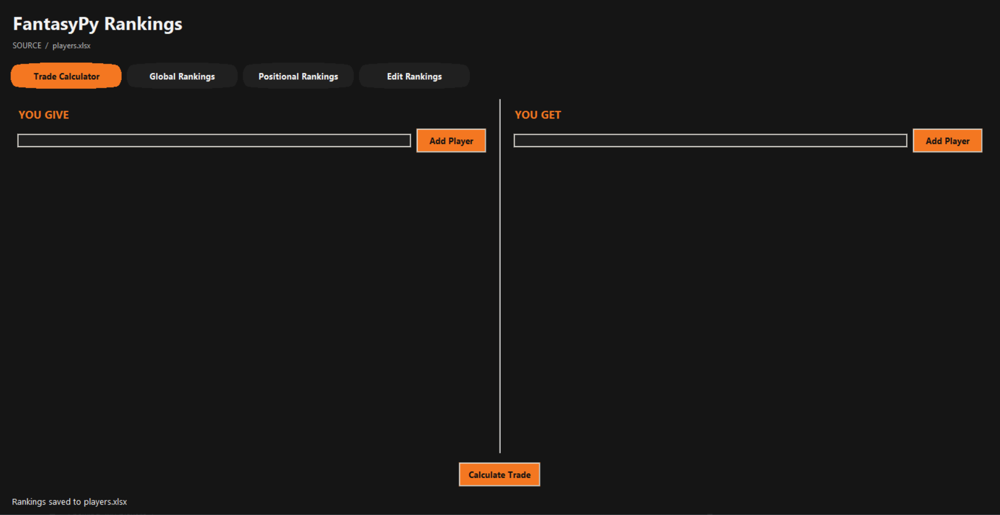
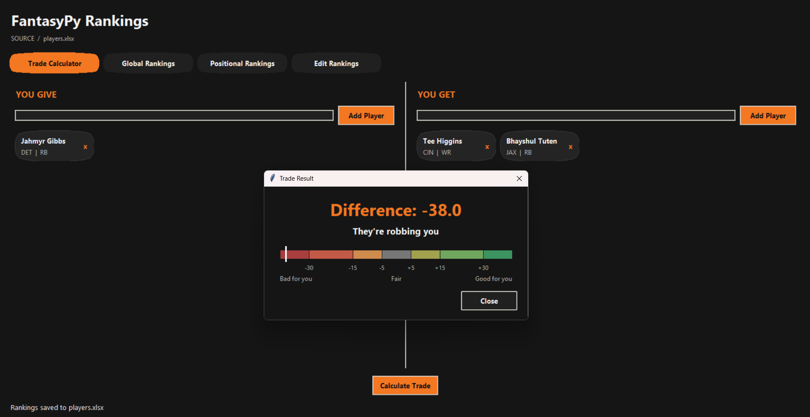

# S1P - Project Status

---

## Current status
FantasyPy has a Python application, an Excel player workbook, a Tkinter rankings interface, command-line workflows, and automated tests. The application supports active QB, RB, WR, and TE player rankings, rank editing, and trade evaluation.

---

## Sprint 1 plan

### Planned features (3/3 complete)
1. **Player data and rankings:** Fetch active NFL player information from Sleeper, calculate global and positional rankings, and store the results in an Excel workbook.
2. **Rankings interface and editing:** Browse global and positional rankings in the desktop interface, search/filter/sort players, edit rankings and trade values, and save changes.
3. **Trade calculator and command-line access:** Compare trade sides in the interface or through the CLI, and provide CLI commands for fetching players and viewing rankings.
---

### Planned requirements (6/6 complete)
1. Support the QB, RB, WR, and TE positions and assign global and position-specific ranks.
2. Store player names, positions, teams, ranks, trade values, and player IDs in the Excel workbook.
3. Display global rankings and the top 10 players at each supported position; omit free agents from rankings and search results.

---
4. Allow ranking edits to shift affected players consistently, recalculate positional ranks after global-rank changes, and save updates to the workbook.
5. Limit trade calculations to the top 150 global players and require each selected player to have a valid trade value from 1 to 100.
6. Provide CLI commands for fetching player data, displaying rankings, and evaluating trades using workbook data.

---

## Code updates
- `Fantasy.py` contains the application, data access, ranking logic, GUI, and CLI.
- The `tests` folder contains unit, acceptance, regression, integration, and rank-shift tests.
- The project README documents the current workflows and usage.

---

## Sprint 1 screenshots
The screenshots below show the current application interface and its main workflows.

---

### Global rankings

---

### Positional rankings

---

### Ranking editor

---

### Trade calculator

---

### Trade result

---

## Line of Code
- **Total Python lines:** 1,103 physical lines across the application and tests, including blank lines.
- `Fantasy.py`: 919 lines.
- `tests/test_acceptance.py`: 34 lines.
- `tests/test_integration.py`: 61 lines.
- `tests/test_rank_shifts.py`: 45 lines.
- `tests/test_regression.py`: 19 lines.
- `tests/test_unit.py`: 25 lines.
- **Planned features:** 3/3 complete.
- **Planned requirements:** 6/6 complete.

---

## S1P outcome
The sprint delivered a working fantasy-football rankings and trade-calculator application with desktop and command-line workflows, Excel-backed player data, ranking edits, and automated tests.

---

## Sprint 2 plans and goals
The next sprint will improve the existing application and add a player information experience.

### Planned features
1. **Updated UI:** Refresh the interface so the rankings and trade workflows are clearer and easier to use.
2. **Player info page:** Add a page where users can view useful information about a selected player.
3. **Better ranking editing:** Improve the ranking-edit workflow to make selecting players and applying rank changes easier and clearer.

---

### Planned requirements
- Keep the updated interface consistent across rankings, player information, editing, and trade views.
- Make player information accessible from the application and present it clearly for the selected player.
- Make ranking changes straightforward to apply and save while maintaining consistent global and positional ranks.
- Preserve compatibility with the current player workbook and existing rankings and trade workflows.

---
